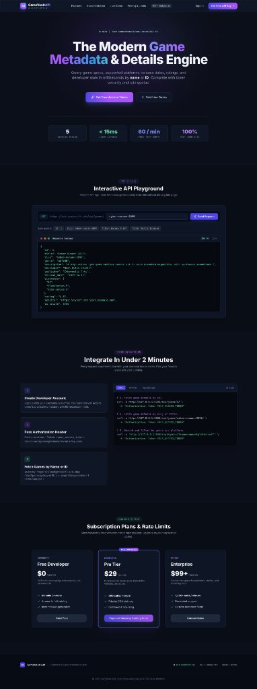
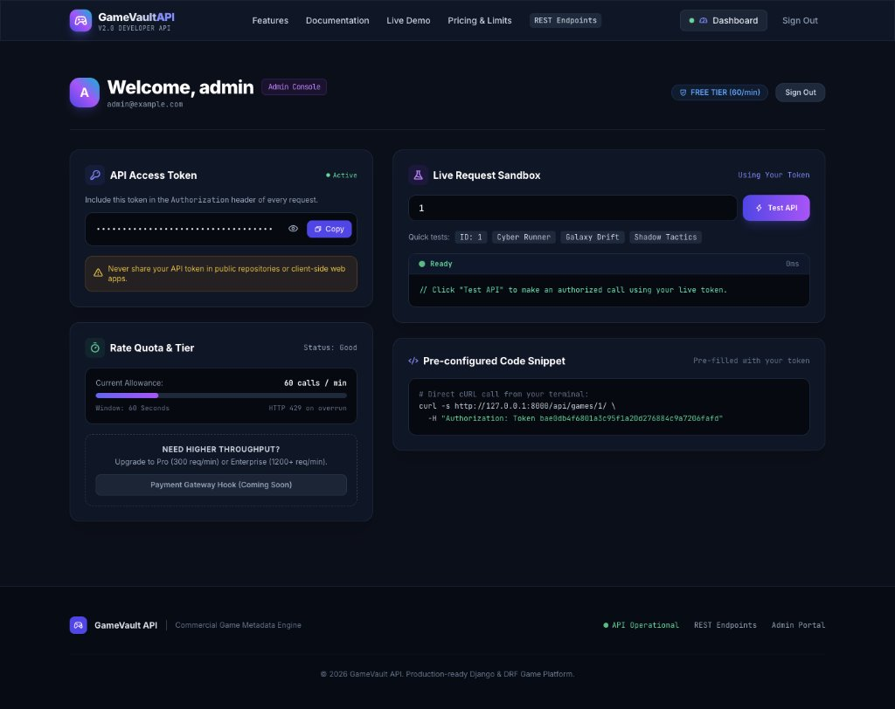
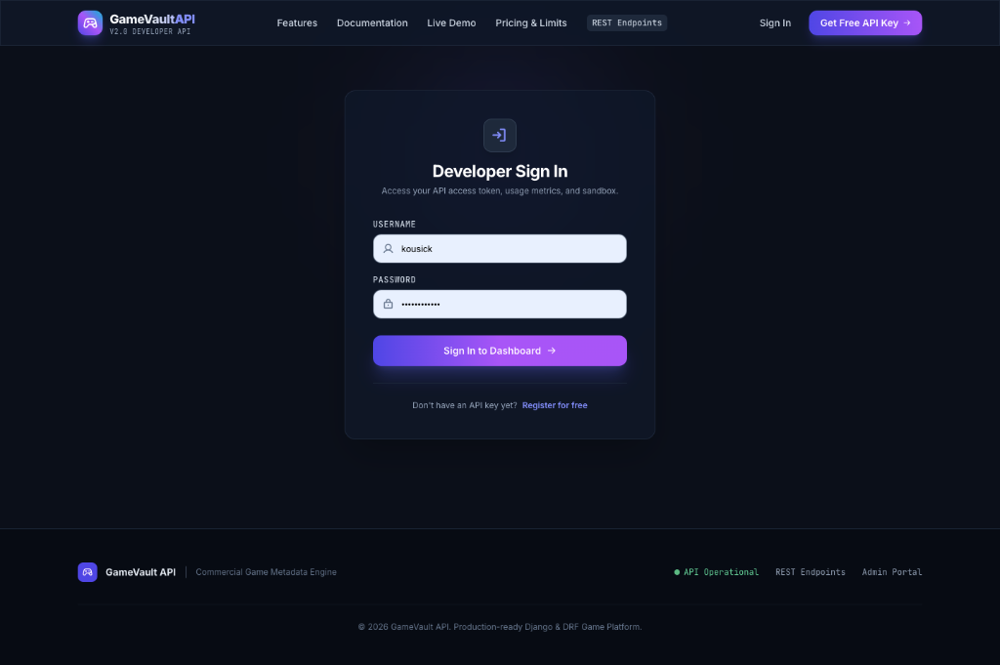
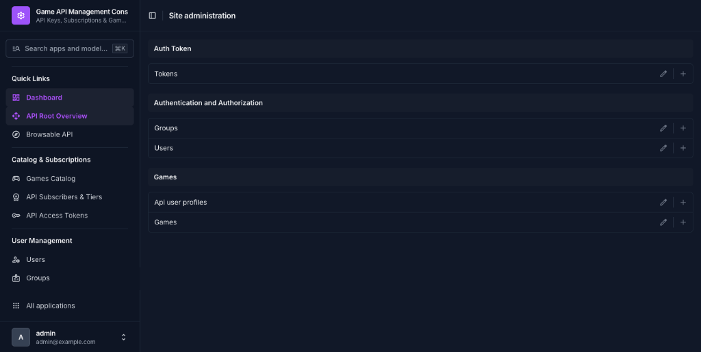

<div align="center">

# 🎮 GameVault API
### Modern Game Metadata Engine, Developer Portal & Monetization Platform

[](https://www.python.org/)
[](https://www.djangoproject.com/)
[](https://www.django-rest-framework.org/)
[](https://www.mysql.com/)
[](https://tailwindcss.com/)
[](#-rate-limits--tiered-monetization)
[](#-automated-testing)

<p align="center">
  <b>A commercial-grade Game Catalog REST API built for high-throughput queries, developer token authentication, and multi-tier subscription quotas. Complete with a live interactive web playground, developer dashboard, and Tailwind-powered Unfold admin console.</b>
</p>

[Explore Landing Page](#-visual-showcase) • [API Documentation](#-api-endpoints-reference) • [Local Setup](#-quick-start-local-development) • [MySQL Deployment](#-production-deployment-with-mysql)

</div>

---

## 📸 Visual Showcase

### 1. Modern Landing Page & Interactive Live Playground
> *Public showcase explaining API integration with live query tester, dynamic latency reporting, and pre-formatted response payloads.*

<div align="center">
  
</div>

---

### 2. Developer Control Center & Token Manager
> *Protected developer dashboard showing active API token with show/hide toggle, live authenticated sandbox, and personalized code snippets.*

<div align="center">
  
</div>

---

### 3. Developer Authentication Portal & Modern Unfold Admin
<div align="center">
  <table>
    <tr>
      <td width="50%" align="center">
        <b>Developer Sign In (<code>/login/</code>)</b><br><br>
        
      </td>
      <td width="50%" align="center">
        <b>Tailwind Unfold Admin (<code>/admin/</code>)</b><br><br>
        
      </td>
    </tr>
  </table>
</div>

---

## ✨ Core Highlights

* 🎮 **Game Details by Name or ID**: Retrieve full game specifications by integer ID (`/api/games/1/`), URL slug (`/api/games/cyber-runner-2099/`), or title query (`/api/games/by-name/?name=Galaxy Drift`).
* 🔐 **Token-Based Authentication**: Secure token provisioning upon sign up. Requests authenticated via standard HTTP header: `Authorization: Token <access_token>`.
* ⏱️ **Rate Limiting (Per-Minute Throttle)**: Dynamic rate throttle protecting infrastructure from abuse with configurable quotas (defaults to 60 calls/minute, returning `HTTP 429 Too Many Requests` on overrun).
* 💳 **Payment Gateway & Paid Tier Ready**: Built-in `ApiUserProfile` model with tiered subscription tracking (`FREE`, `PRO`, `ENTERPRISE`), ready for Stripe, LemonSqueezy, or Razorpay integration.
* 🗄️ **Dual Database Architecture**: Zero-config **SQLite** for rapid local development and automated CI testing, with turnkey **MySQL 8.0** support for production.
* 🖥️ **Full-Featured Web Frontend**: Includes landing page, developer registration, sign-in, and private developer dashboard.
* 🎨 **Tailwind Unfold Admin**: Clean, SEO-friendly administrative paths (`/admin/games/`, `/admin/subscribers/`, `/admin/tokens/`) with automatic 301 redirects from legacy URLs.

---

## 🗺️ Web & API Route Map

| Category | Endpoint | Access | Purpose |
| :--- | :--- | :--- | :--- |
| **Landing Page** | `GET /` | Public | Product overview, live demo playground, integration code |
| **Sign Up** | `GET, POST /signup/` | Public | Developer registration; auto-provisions API token & free quota |
| **Sign In** | `GET, POST /login/` | Public | Developer session authentication |
| **Sign Out** | `GET /logout/` | Protected | Clears session and redirects to landing page |
| **Developer Console**| `GET /dashboard/` | Protected | Manage API token, inspect quota, and test requests |
| **Admin Console** | `GET /admin/` | Staff Only | Modern Django Unfold portal for game catalog and token audits |
| **List Games** | `GET /api/games/` | Token Auth | Filter catalog by `?name=`, `?genre=`, `?platform=` |
| **Game Details** | `GET /api/games/{id_or_name}/` | Token Auth | Fetch game by numeric ID or slug/title |
| **Name Query API** | `GET /api/games/by-name/?name=` | Token Auth | Explicit game search by exact/partial title |
| **Token Generation**| `POST /api/auth/token/` | Public | Programmatic token retrieval for automated scripts |
| **Account Info** | `GET /api/auth/me/` | Token Auth | Returns developer profile, tier, and remaining allowance |

---

## ⏱️ Rate Limits & Tiered Monetization

The API implements a sliding per-minute rate window. Upgrading a user's subscription in the admin portal (or via future payment webhooks) instantly unlocks higher throughput:

| Subscription Tier | Rate Limit | Monthly Price | Intended Use Case |
| :--- | :--- | :--- | :--- |
| 🟢 **Free Tier** | **60 calls / min** | **$0** | Indie developers, personal bots, prototyping |
| 🟡 **Pro Tier** | **300 calls / min** | **$29** | Commercial mobile applications & web games |
| 🟣 **Enterprise Tier**| **1,200+ calls / min** | **$99+** | High-traffic publishers, streaming overlays |

---

## 💻 Quick Start (Local Development)

### Cross-Platform Setup

```bash
# Clone the repository
git clone https://github.com/<your-username>/gamevault-api.git
cd gamevault-api
```

#### Option A: macOS & Linux (1-Command Script)
```bash
./setup_mac.sh
```

#### Option B: Windows (1-Click Batch Script)
```cmd
setup_windows.bat
```

#### Option C: Manual Setup (Any OS)
```bash
# 1. Create and activate virtual environment
python3 -m venv env
source env/bin/activate       # On Windows: env\Scripts\activate

# 2. Install dependencies
pip install -r requirements.txt

# 3. Apply database migrations
python manage.py migrate

# 4. Seed initial games catalog & admin account
python manage.py seed_data

# 5. Start development server
python manage.py runserver
```

Open [http://127.0.0.1:8000/](http://127.0.0.1:8000/) in your browser. Default superuser credentials:
* **Username**: `admin`
* **Password**: `admin123`

---

## 🚀 Production Deployment with MySQL

This section walks through deploying **GameVault API** to a production Linux server (Ubuntu 22.04 / 24.04 LTS) using **MySQL 8.0**, **Gunicorn**, and **Nginx**.

### Architecture Overview
```text
Clients / Apps ---> [ Nginx (Port 80/443 SSL) ]
                           │
                           ▼ (Reverse Proxy)
                  [ Gunicorn WSGI (Port 8000) ]
                           │
                           ▼
                  [ Django Application ]
                           │
                           ▼
                  [ MySQL 8.0 Database ]
```

---

### Step 1: Install MySQL Server and System Packages

```bash
# Update system repositories
sudo apt update && sudo apt upgrade -y

# Install Python environment, MySQL server, and build headers
sudo apt install -y python3-pip python3-venv python3-dev \
                    default-libmysqlclient-dev build-essential \
                    mysql-server nginx curl git
```

---

### Step 2: Configure MySQL Database and Dedicated User

Log into MySQL as root:
```bash
sudo mysql
```

Run the following SQL commands to provision a dedicated database and secure user:
```sql
-- 1. Create database with utf8mb4 encoding (supports international characters & symbols)
CREATE DATABASE gamevault_db CHARACTER SET utf8mb4 COLLATE utf8mb4_unicode_ci;

-- 2. Create dedicated production user
CREATE USER 'gamevault_user'@'localhost' IDENTIFIED BY 'YourStrongProductionPassword_123!';

-- 3. Grant privileges
GRANT ALL PRIVILEGES ON gamevault_db.* TO 'gamevault_user'@'localhost';

-- 4. Flush privileges and exit
FLUSH PRIVILEGES;
EXIT;
```

---

### Step 3: Clone Project & Configure Production Environment

```bash
# Create application directory
sudo mkdir -p /var/www/gamevault
sudo chown -R $USER:$USER /var/www/gamevault

# Clone repository
git clone https://github.com/<your-username>/gamevault-api.git /var/www/gamevault
cd /var/www/gamevault

# Create and activate virtual environment
python3 -m venv env
source env/bin/activate

# Install dependencies (including PyMySQL)
pip install --upgrade pip
pip install -r requirements.txt
pip install gunicorn
```

#### Create the Production Environment File (`.env`):
Create `/var/www/gamevault/.env`:
```ini
# Security
DJANGO_SECRET_KEY=generate_a_random_64_char_secret_key_here
DEBUG=False
ALLOWED_HOSTS=api.yourdomain.com,127.0.0.1,localhost

# Database Configuration (Activates MySQL)
DB_ENGINE=mysql
DB_NAME=gamevault_db
DB_USER=gamevault_user
DB_PASSWORD=YourStrongProductionPassword_123!
DB_HOST=127.0.0.1
DB_PORT=3306
```

---

### Step 4: Run Migrations, Collect Static & Seed Data

```bash
# Export environment variables
export $(cat .env | xargs)

# Run database migrations against MySQL
python manage.py migrate

# Populate sample game catalog and admin account
python manage.py seed_data

# Collect all static files for Nginx to serve
python manage.py collectstatic --noinput
```

---

### Step 5: Configure Gunicorn Systemd Service

Create a systemd unit file to manage the Gunicorn application process:
```bash
sudo nano /etc/systemd/system/gamevault.service
```

Paste the following configuration:
```ini
[Unit]
Description=Gunicorn daemon for GameVault API
After=network.target mysql.service

[Service]
User=www-data
Group=www-data
WorkingDirectory=/var/www/gamevault
EnvironmentFile=/var/www/gamevault/.env
ExecStart=/var/www/gamevault/env/bin/gunicorn \
          --workers 3 \
          --bind 127.0.0.1:8000 \
          --access-logfile /var/log/gunicorn/access.log \
          --error-logfile /var/log/gunicorn/error.log \
          config.wsgi:application

Restart=always
RestartSec=3

[Install]
WantedBy=multi-user.target
```

Enable and start the service:
```bash
sudo mkdir -p /var/log/gunicorn
sudo chown -R www-data:www-data /var/log/gunicorn /var/www/gamevault
sudo systemctl daemon-reload
sudo systemctl start gamevault
sudo systemctl enable gamevault

# Check service status
sudo systemctl status gamevault
```

---

### Step 6: Configure Nginx as Reverse Proxy

Create Nginx site configuration:
```bash
sudo nano /etc/nginx/sites-available/gamevault
```

Paste the configuration:
```nginx
server {
    listen 80;
    server_name api.yourdomain.com;

    # Static assets served directly by Nginx for max performance
    location /static/ {
        alias /var/www/gamevault/staticfiles/;
        expires 30d;
        add_header Cache-Control "public, max-age=2592000";
    }

    # Pass all other requests to Gunicorn
    location / {
        proxy_pass http://127.0.0.1:8000;
        proxy_set_header Host $host;
        proxy_set_header X-Real-IP $remote_addr;
        proxy_set_header X-Forwarded-For $proxy_add_x_forwarded_for;
        proxy_set_header X-Forwarded-Proto $scheme;
        client_max_body_size 20M;
    }
}
```

Enable site and test configuration:
```bash
sudo ln -s /etc/nginx/sites-available/gamevault /etc/nginx/sites-enabled/
sudo nginx -t
sudo systemctl restart nginx
```

#### (Optional) Enable Free HTTPS with Let's Encrypt:
```bash
sudo apt install -y certbot python3-certbot-nginx
sudo certbot --nginx -d api.yourdomain.com
```

---

### Step 7: (Alternative) 1-Command Docker Compose Deployment

If you prefer containerized deployment with Docker:

```bash
# 1. Start MySQL and GameVault API containers
docker compose up -d --build

# 2. Check running services
docker compose ps

# 3. View live server logs
docker compose logs -f web
```
The API will be live at `http://localhost:8000` connected to the MySQL 8 container.

---

## 🧪 Automated Testing

GameVault API maintains 100% passing test coverage across endpoints, authentication, rate limit throttling, and admin routing:

```bash
python manage.py test
```

**Test Suite Coverage:**
* ✅ User registration & automated token generation
* ✅ User login & credential verification
* ✅ 401 Unauthorized barrier for missing/invalid tokens
* ✅ Game lookup by ID (`/api/games/1/`)
* ✅ Game lookup by URL slug (`/api/games/cyber-runner-2099/`)
* ✅ Game lookup by name parameter (`/api/games/by-name/?name=...`)
* ✅ Catalog searching & platform filtering
* ✅ Sliding window per-minute rate throttling (`HTTP 429`)
* ✅ Modern SEO-friendly admin routes (`/admin/games/`)
* ✅ 301 permanent redirect fallbacks
* ✅ Landing page, signup, login, and dashboard web rendering

---

## 📄 License & Contributing

Distributed under the **MIT License**. Contributions, bug reports, and feature requests are welcome via pull requests and GitHub Issues.

<div align="center">
  <sub>Built with ❤️ using Python, Django, DRF, and Tailwind CSS.</sub>
</div>
